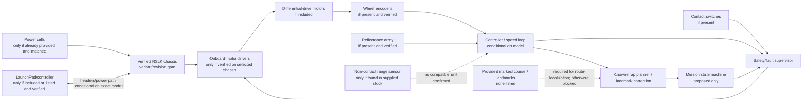

# 01 — Conditional system block diagram

**Applicability:** research reference only, conditional on physical confirmation of TI-RSLK MAX / TIRSLK-EVM. Nothing in this diagram confirms that the lab owns that variant. Cells, route markers/course, compatible range sensing, host software, and exact sensor contents are not established by the supplied inventory; no additions are planned.

## Interpretation

- RSLK identity, component presence, controller, and wiring are unverified; the MAX-specific diagram is conditional.
- The inventory does not list a prepared course or floor markers. Without explicitly provided landmarks, route-localization tests are blocked.
- A compatible non-contact range sensor has not been found in supplied stock. Without one, the obstacle-detection MVP is blocked; bump switches are contact-only.
- No external sensor kit, additional MCU, PC/software, or other hardware is included in this plan. No system test or data have been recorded.
