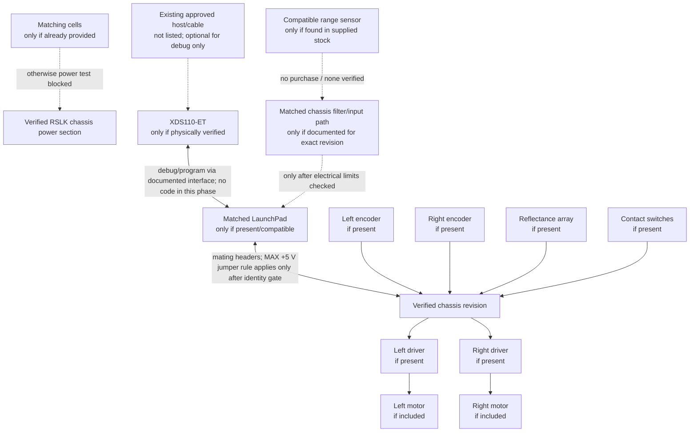

# 02 — Conditional hardware connection diagram

**Conditional drawing:** reference only if the physical unit is verified as TI-RSLK MAX. The inventory does not confirm that platform. No wiring instruction is valid until board and revision match the official source. Do not add or substitute parts.

## Connection constraints

- Do not mate boards or power the robot until the exact model/revision and official construction/power instructions are verified.
- For a confirmed MAX only, follow TI's guide for the LaunchPad header and +5 V jumper. Do not transfer that instruction to a different chassis without its own manual.
- Do not connect an unidentified sensor. Use a sensor's datasheet and chassis schematic only if the exact sensor is already in the supplied stock and the interface matches.
- A sensor/power/course/software absence is a blocker, not a reason to add a part or find a substitute.
- The conditional logical signal mappings are in [hardware/pin-map.md](../hardware/pin-map.md); there is no universal RSLK pin map.
