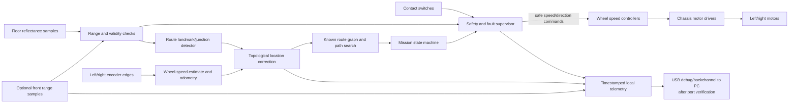

# 03 — Data flow

## Logging fields to freeze during implementation

`time_ms, trial_id, robot_id, mission_state, node_id, edge_id, target_node, left_encoder_delta, right_encoder_delta, left_speed, right_speed, estimated_pose, reflectance_raw, range_raw, range_valid, bump_bits, commanded_left, commanded_right, fault_code, event_code`.

Units, sampling interval, integer scales, calibration version, missing-value encoding, and firmware version must be defined before data collection. No sample data are supplied here.
