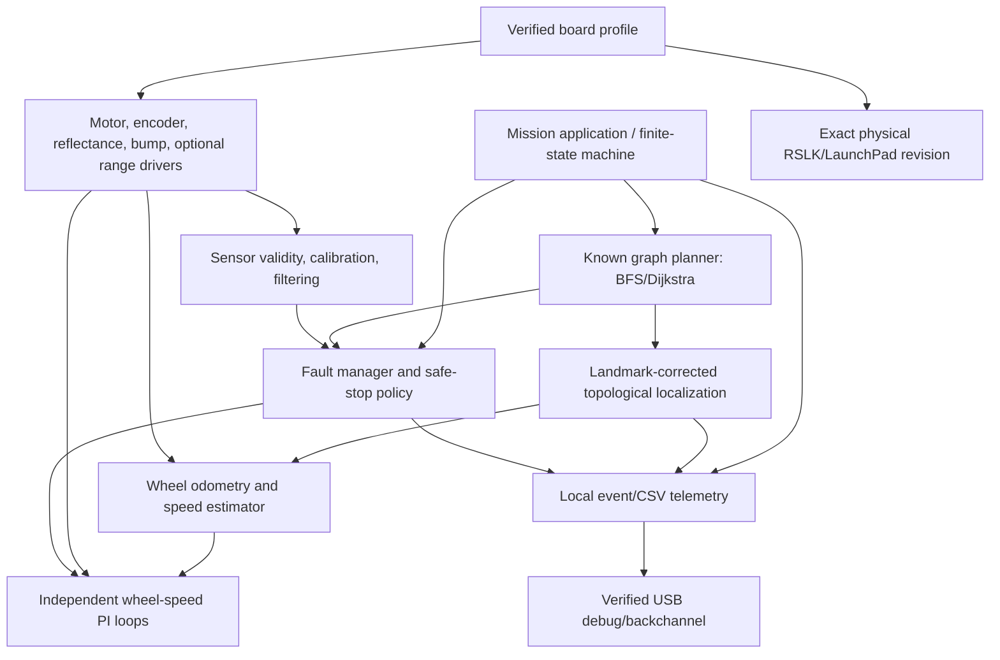

# 04 — Software architecture

## Design constraints

- Keep the chassis/LaunchPad pin configuration in one explicit, revision-named profile.
- Start in motor-disabled state. Only the fault supervisor can authorize nonzero wheel setpoints.
- Keep time-critical encoder capture/control out of blocking display, logging, or PC I/O code.
- Use no RTOS until a measured requirement justifies it; the first implementation is a small deterministic C state machine.
- This is an architecture proposal. No module or code is implemented yet.
