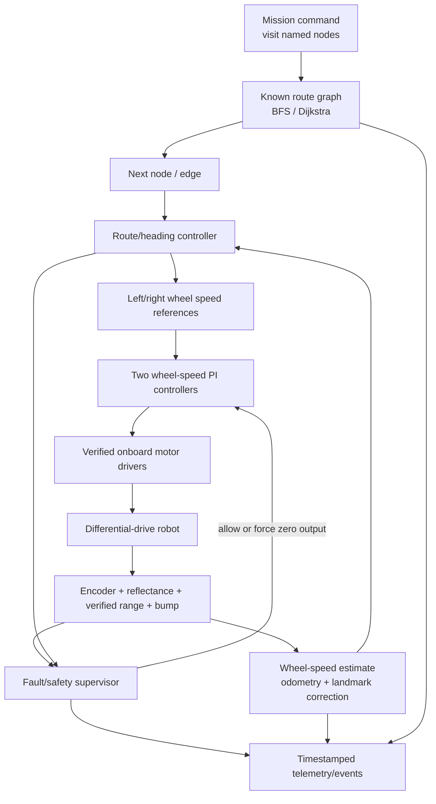
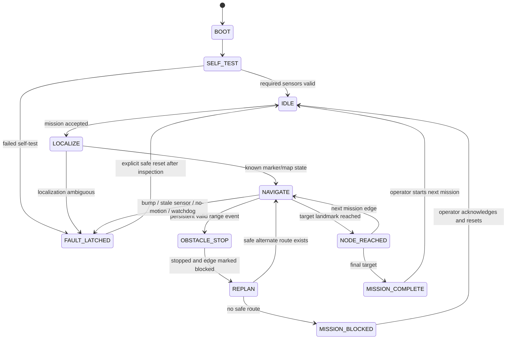

# Project 01 — System, Control, and Navigation Architecture

**Status:** proposed architecture for a conditional TI-RSLK MAX reference; not bench-verified. If hardware identification selects a different RSLK revision, update this document before firmware work.

## 1. Design boundary

The platform is a proposed small differential-drive educational robot, conditional on the exact RSLK being identified. The system would need a flat, bounded, pre-marked route graph, but no course/landmarks are listed in the supplied inventory. Without an explicitly provided course and all necessary in-stock sensors/power, the route-localization/obstacle-detection MVP is blocked. No SLAM, unrestricted obstacle avoidance, precise absolute position, safety-rated perception, or real-factory autonomy is claimed.

Use only the base RSLK and sensors found in the supplied inventory. Inspect the three RSLK Sensors sets for a compatible non-contact range sensor. If one is present, use it only after its model and interface are verified. If none is present, do not add one: document non-contact obstacle detection as blocked and continue to the next project. The inventory also does not list power cells or a marked test course/landmarks; if those are not explicitly provided within the selected kit/resources, power/navigation tests are blocked. See [hardware verification](../hardware/VERIFICATION.md), [pin map](../hardware/pin-map.md), and [BOM](../BOM/bom.md).

## 2. System architecture

The safety supervisor is higher priority than navigation: any bump, invalid/stale required range reading, encoder no-motion fault, watchdog expiry, or operator stop inhibits motion. When safe, navigation supplies bounded wheel-speed setpoints to the two wheel controllers.

## 3. Control architecture

### 3.1 Layered control

1. **Motor-driver interface:** verified direction, PWM/enable, and sleep pins for the exact chassis. Startup and fault state keep both drivers disabled.
2. **Wheel-speed feedback:** estimate each wheel's speed from encoder deltas over a measured interval, using per-robot counts-per-distance calibration.
3. **Wheel-speed controller:** start with independent PI loops and output saturation/anti-windup. Tune one wheel at a time with the robot secured on blocks, then check under bounded floor load. A feed-forward term may be considered only after a baseline is measured.
4. **Route controller:** convert desired body velocity and turn rate into wheel-speed references for track width `b`:
   - `v_left* = v - (b / 2) × ω`
   - `v_right* = v + (b / 2) × ω`
   where `v` is desired linear speed and `ω` is desired yaw rate; use consistent units and wheel signs.
5. **Speed governor:** cap speed using the validated sensor update latency, measured stopping distance, route clearance, and landmark/localization confidence. Do not select a fixed rate before characterizing sensors and motors.

### 3.2 Timing and fault behavior

- Select encoder/control update periods after measuring encoder event rates, motor response, MCU workload, and range sensor update period. The optional GP2Y0A21YK0F page specifies an update interval of 38 ± 10 ms; a control loop must not treat slower range updates as new data.
- Keep periodic control work bounded and avoid blocking serial/log output in timing-critical code.
- Detect non-fresh sensor values by timestamp/sequence age, not by a plausible-looking number alone.
- Detect a likely no-motion/jam condition only as a conservative commanded-motion-versus-encoder fault; there is no confirmed motor-current sensor, so do not call this overload measurement.
- When a limit/fault is hit: force zero motor command, latch/log the fault, and require an explicit safe reset procedure. The operator retains a physical power-off path.

### 3.3 Control validation metrics

Use measured rise/settling time, steady-state speed error, left/right mismatch, oscillation, response to a bounded load change, and control execution time. Establish target tolerances from actual hardware variation and project requirements before claiming a pass.

## 4. Navigation architecture

### 4.1 World representation

- **Route graph:** vertices are named stations, junctions, or recognizable floor markers; edges are allowed corridors with measured lengths and speed limits.
- **Landmark representation:** a marker/junction detector emits `(marker_id, confidence, timestamp)` from calibrated reflectance channels. Use robust marker geometry that can be distinguished from ordinary floor; do not assume every line intersection has a unique identity.
- **Local state:** current route node/edge, heading class, distance/progress along the edge from calibrated encoder odometry, mission target, and sensor/fault validity.
- **No global occupancy map is inferred:** the graph is configured from the test course. A detected obstacle marks an edge temporarily blocked; unknown space remains unknown and unsafe.

### 4.2 Localization

Differential-drive increments provide relative travel only:

- `Δs_left = calibrated_left_scale × encoder_delta_left`
- `Δs_right = calibrated_right_scale × encoder_delta_right`
- `Δs = (Δs_left + Δs_right)/2`
- `Δθ = (Δs_right − Δs_left)/b`

Integrate these between verified landmarks. At a recognized node, snap the discrete graph state to the known landmark and reset the segment progress. Track confidence/validity and reject an ambiguous marker instead of silently changing nodes. Report metric error using independent floor measurements.

This is landmark-corrected odometry/topological localization, not a Kalman-filtered global pose or SLAM system. No IMU/compass/absolute-position sensor is confirmed.

### 4.3 Planning and obstacle response

- For equal-cost edges, BFS is sufficient. For nonnegative measured edge costs (length/time/known risk), use Dijkstra. Avoid a more complex optimizer until a measured need exists.
- Generate a route from current node to goal over edges not marked blocked.
- During traversal, a calibrated, valid, persistent range event requests a controlled stop before the obstacle. Determine threshold/hysteresis from sensor measurements and braking tests.
- Mark the current edge blocked and search for a known alternate route. Do not drive around an obstacle outside the mapped corridor.
- If the route is ambiguous, all range samples are stale, a bump occurs, or no path remains, stop and report the fault/blocked mission.

### 4.4 Proposed mission state machine

The supervisor must be implemented so that navigation or communication cannot override a latched stop.

## 5. Algorithm selection

| Need | Selected MVP method | Why it fits | Not selected / limitation |
|---|---|---|---|
| Reflectance noise | Median/persistence or simple hysteresis after raw characterization | Deterministic, small CPU/RAM cost, easy to validate | No generic filter settings before sensors/track are measured |
| Wheel velocity | Encoder period/count estimate over a characterized interval | Uses stock encoder feedback if verified | Low speed can have sparse counts; choose measurement strategy from real data |
| Wheel control | Independent PI with saturation and anti-windup | Minimal closed-loop controller for speed matching | No adaptive/MPC controller until baseline measurements show need |
| Pose between markers | Differential-drive odometry with calibrated wheel scales/track width | Appropriate for short segments; uses existing encoders | Accumulates slip/kinematic error; not absolute positioning |
| Route position | Reflectance landmark correction over a known graph | Corrects discrete route location without extra localization hardware | Depends on marked floor and reliable marker recognition |
| Route planning | BFS or Dijkstra on known graph | Bounded, explainable, easy to unit-test | Cannot discover arbitrary unknown space |
| Obstacle response | Range validity + persistence → stop → blocked edge → graph replan | Conservative for sparse sensing and known routes | Not a general local planner; moving obstacles/side/rear blind spots remain |
| Fault handling | Explicit finite-state machine and latched safe stop | Auditable behavior and deterministic recovery | Software stop is not certified and does not replace physical power-off |
| Learning/classification | No ML | Small, interpretable state; limited initial data; conventional methods are appropriate | Reconsider only if a measured classification problem and sufficient labeled data emerge |

## 6. Data, interfaces, and acceptance gate

If a logging host/tool is already provided, proposed local logs should carry monotonic timestamps, trial/configuration ID, mission state, node/edge, encoder deltas/speed, reflectance raw values, range raw value/validity, bump bits, wheel commands, fault/event, and independent reference measurements. No host/software is identified in the hardware inventory; if unavailable, logging/analysis remains blocked. Freeze units and schemas in [data/README.md](../data/README.md).

Proceed to implementation only after:

- exact controller/chassis/sensor variant is physically confirmed;
- pin and power maps match the correct manufacturer documentation;
- a compatible non-contact range sensor, matching power cells, and a pre-marked test course/landmarks are explicitly provided in listed stock/resources;
- a compatible toolchain/logging host and an operator stop/safe test area are already provided;
- a board-only smoke test succeeds;
- individual sensor and wheel-encoder tests pass.

Then add one module at a time and keep motor output disabled until its relevant gate passes.
