# 01 — Conditional system block diagram

> Research architecture only. Band model, host, SDK, and access are unverified. No code or data flow has been tested. The candidate path applies only if the physical unit and already-available official software match.

```mermaid
flowchart LR
    Band["Listed Neuro Sense Band<br/>manufacturer/model unknown"]
    Link["Manufacturer-supported link<br/>conditional candidate: BLE/SDK"]
    Host["Existing host and official app/SDK<br/>not listed/verified"]
    Quality["Freshness + contact/signal-quality gate"]
    Gate["Per-user threshold<br/>dwell + hysteresis + cooldown"]
    HMI["Local HMI request/status"]
    Human["Human confirms or rejects"]
    Log["Approved, minimal, pseudonymized summary"]
    Stop["Invalid/stale/disconnected/uncertain<br/>suppress request and return idle"]

    Band -. "only after physical identity gate" .-> Link
    Link -. "only if official access already exists" .-> Host
    Host --> Quality
    Quality -->|valid and fresh| Gate
    Quality -->|invalid| Stop
    Gate -->|stable state| HMI
    Gate -->|ambiguous/timeout| Stop
    HMI --> Human
    HMI --> Log
    Human -->|reject/no response| Stop

    RSLK["P01 RSLK integration<br/>not in first-stage MVP"]
    Human -. "separate future safety review only" .-> RSLK
```

No output in this diagram actuates a robot or other device.
