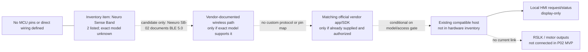

# 02 — Conditional hardware/interface connection

> No physical device or host has been verified. No pins, wires, supply rails, or BLE characteristics are defined. This diagram shows a candidate software link only, not a confirmed lab connection.

Do not wire the band to any MSP432 or BoosterPack, scan undocumented services, or connect a robot based on this drawing.
