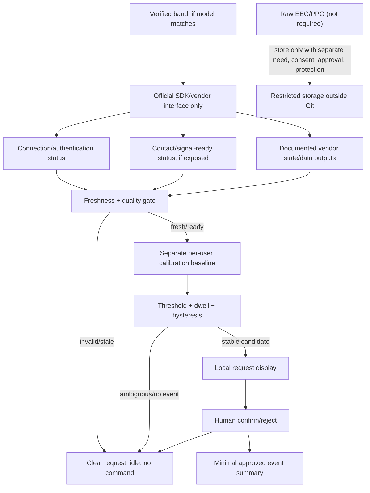

# 03 — Conditional data flow

> Proposed only. The inventory model and available SDK are unknown. Exact fields, units, timestamps, callback cadence, and retention must come from the matching official SDK documentation.

Suggested event-summary fields after approval: random session ID, monotonic timestamp, model/software version, connection/quality/freshness status, condition, event marker, request/confirm/reject status, latency, outcome, and exclusions. Do not store names, serials, credentials, raw personal data, or unapproved samples. No sample dataset is supplied.
