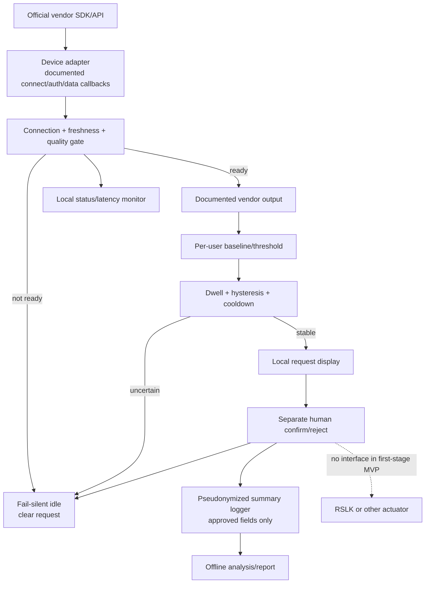

# 04 — Conditional host software architecture

> No software has been selected, installed, or implemented. Blocks below are conceptual and apply only if the physical band, existing host, supported official SDK, and authorized access all match.

No custom BCI classifier, web/cloud service, robot control, or firmware is included. Raw signal storage is not required for the initial request-gating evaluation and remains outside Git.
