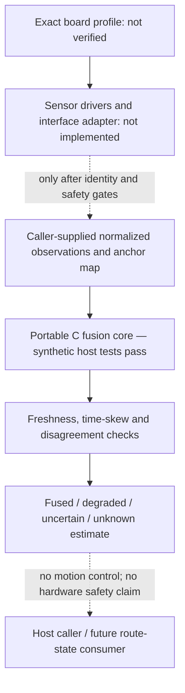

# RSLK Sensor Fusion and Autonomous Perception — Software Architecture

The host-tested core is hardware-independent and takes synthetic/caller-supplied inputs. No board profile, sensor driver, interface adapter, target build, or physical test is confirmed. Do not interpret this diagram as a wiring map or as evidence of lab sensor contents.
