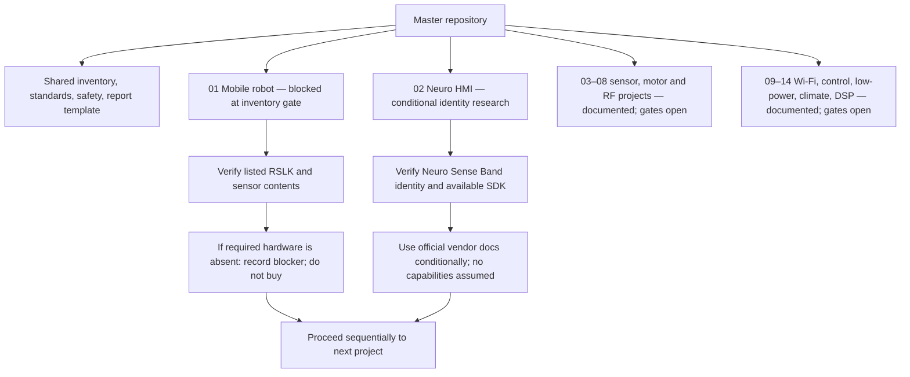

# Innovation Center Advanced Engineering Projects

A hardware-first monorepo for engineering projects built primarily from the equipment already held by the Innovation Center. Projects are developed **one at a time**, documented for reproducibility, and structured so a completed project can later be extracted into its own GitHub repository.

> **Engineering rule:** buildability and verified hardware take priority over complexity. The supplied inventory names some product families without part numbers or revisions. Conditional manufacturer research is not evidence of physical kit identity; no pinout or firmware is bench-verified.

## Overview

This repository contains shared development standards and 14 project workspaces. P01/P02 research is conditional on physical inventory identity; documentation has now proceeded sequentially through P14. P03–P14 include source-backed research, inventory-only BOMs, hardware gates, test plans, and explicit blockers. P03 also has a hardware-independent C fusion core with passing synthetic host tests; it is not board-target firmware or hardware evidence. No other project firmware/application integration or physical results are claimed. When a project is blocked by missing identity/equipment/software, record progress, do not add unlisted dependencies, and continue.

- Full inventory and provisional project reservations: [HARDWARE_INVENTORY.md](HARDWARE_INVENTORY.md)
- Evidence, build, test, and release conventions: [DEVELOPMENT_STANDARDS.md](DEVELOPMENT_STANDARDS.md)
- Shared safety requirements: [SAFETY.md](SAFETY.md)
- How to contribute: [CONTRIBUTING.md](CONTRIBUTING.md)
- Report template: [docs/FINAL_REPORT_TEMPLATE.md](docs/FINAL_REPORT_TEMPLATE.md)
- License decision: [LICENSE](LICENSE) (**pending; this is not an open-source license**)

## Repository readiness

All 14 project workspaces have the standard documentation, inventory-only BOM, verification gates, test plans, diagrams, and changelog. This means the repository is prepared for disciplined project work; it does **not** mean every physical build is ready. Exact board/sensor identities, compatible hosts/toolchains, safety conditions, or test equipment remain unresolved for individual projects in [PROJECT_STATUS.md](PROJECT_STATUS.md). P03's portable algorithm is the only host-tested code; it is not target firmware. No project is claimed as physically working.

Run `make test` to validate the 14-project structure, required docs, local Markdown links, fences and whitespace, and to compile/run P03's synthetic host tests. It requires Python 3, GNU Make, and a C11 host compiler. This does not compile or flash any board firmware. These checks are configured in GitHub Actions.

## Hardware inventory

The supplied inventory reports the following quantities; full planned reservations and verification notes are in [HARDWARE_INVENTORY.md](HARDWARE_INVENTORY.md).

| Hardware | Quantity |
|---|---:|
| Robotics System Lab Kit (RSLK) | 10 |
| RSLK Sensors | 3 sets |
| Neuro Sense Band | 2 |
| CC110L Booster Pack | 2 |
| TIVA LaunchPad | 5 |
| SenseHUB Booster Pack | 2 |
| BOOSTXL-CC1125 | 2 |
| BOOSTXL-CC2650MA | 2 |
| SimpleLink Wi-Fi CC3100 Booster Pack | 2 |
| CC3200SF LaunchPad | 2 |
| MSP432P401R LaunchPad | 2 |
| MSP430F5529 LaunchPad | 4 |
| Generic Sensors | 1 set |
| OMAP-L138 DSP Kit | 1 |

Exact RSLK family/version, board revisions, sensor part numbers, kit completeness, and battery stock still need physical inspection. The published TI-RSLK MAX configuration is documented as a **conditional reference**, not as proof that the lab's ten units are MAX kits.

## Project list and status

| # | Project | Primary inventory hardware | Status |
|---:|---|---|---|
| 01 | [Autonomous Industrial Mobile Robot](01-autonomous-industrial-mobile-robot/README.md) | RSLK; RSLK sensor sets only if compatible | 🟡 In Development — exact kit/sensor/power/course verification remains blocked |
| 02 | [Neuro-Controlled Human-Robot Interface](02-neuro-controlled-hmi/README.md) | Neuro Sense Band; host software only if already available | 🟡 In Development — conditional candidate; exact model/SDK access unverified |
| 03 | [RSLK Sensor Fusion and Autonomous Perception](03-rslk-sensor-fusion/README.md) | RSLK and RSLK sensor sets | 🟡 In Development — portable core host-tested; exact platform/modalities unknown; no physical fusion data |
| 04 | [Long-Range Industrial Emergency Wireless Network](04-cc110l-emergency-network/README.md) | Two CC110L BoosterPacks; host/RF profile unverified | 🟡 In Development — no RF transmission; not a safety/emergency system |
| 05 | [Real-Time Industrial Motor Condition Monitoring](05-tiva-motor-condition-monitor/README.md) | TIVA LaunchPad; motor/feedback path not identified | 🔴 Blocked — no verified in-stock plant/measurement path |
| 06 | [Distributed Sensor Fusion using SenseHUB](06-sensehub-sensor-fusion/README.md) | SenseHUB BoosterPack and conditional compatible TIVA | 🟡 In Development — hardware/software identity gates remain |
| 07 | [Sub-GHz Industrial Asset Tracking and Telemetry](07-cc1125-asset-tracking/README.md) | Two BOOSTXL-CC1125 and conditional F5529 hosts | 🟡 In Development — RF approval required; two-node link only |
| 08 | [BLE Industrial Proximity and Safety System](08-cc2650-ble-proximity/README.md) | Two BOOSTXL-CC2650MA and two MSP432P401R LPs | 🟡 In Development — informational non-safety scope; SDK/RF gates open |
| 09 | [CC3100 Embedded Industrial Web/Data Acquisition System](09-cc3100-industrial-web-daq/README.md) | Two CC3100 BoosterPacks; conditional F5529 hosts | 🟡 In Development — browser client/sensor/software not inventoried |
| 10 | [CC3200 Autonomous Industrial IoT Edge Gateway](10-cc3200-edge-gateway/README.md) | CC3200SF LaunchPads; onboard sensors conditional | 🟡 In Development — board revision/sensor population/SDK unverified |
| 11 | [MSP432 Real-Time Adaptive Industrial Control System](11-msp432-adaptive-control/README.md) | MSP432P401R LaunchPad; no plant identified | 🔴 Blocked — no in-stock plant, actuator or sensor |
| 12 | [MSP430 Ultra-Low-Power Industrial Sensor Node](12-msp430-low-power-node/README.md) | MSP430F5529 LaunchPad | 🟡 In Development — ammeter absent/unconfirmed; energy test blocked |
| 13 | [Industrial Climate Anomaly Detection and Automatic Response](13-industrial-climate-anomaly/README.md) | One generic sensor set; contents unknown | 🔴 Blocked — sensor/host/logger/actuator unidentified |
| 14 | [OMAP-L138 Real-Time DSP Machine Fault Diagnosis](14-omap-l138-dsp-diagnostics/README.md) | OMAP-L138 DSP Kit; exact variant unknown | 🔴 Blocked — emulator and audio acquisition source unverified |

Status meanings: 🔴 Not Started / Blocked · 🟡 In Development · 🟢 Working · 🔵 Advanced · ⚫ Archived. “Working” and “Advanced” require reproducible physical test evidence; documentation or simulator results alone do not qualify.

## Architecture map

## Project 01 status — blocked, inventory-only

TI documentation describes a **conditional** TI-RSLK MAX / TIRSLK-EVM reference, but the supplied inventory only says “RSLK”; no physical unit has been identified. The contents of the three “RSLK Sensors” sets, LaunchPad pairing, battery stock, and any provided route/course markers are unverified or not listed. P01 uses only supplied items. Planned external purchases are **$0**. Without verified power, a compatible in-stock non-contact sensor, and a provided course/landmarks, the full MVP is blocked; bump switches are contact-only and do not replace range sensing. Record the result and continue without ordering an add-on.

P01's proposed architecture and conditional hardware verification checklist remain useful desk research, but no buildability, pinout, firmware, or measured results are claimed. See [P01 hardware verification](01-autonomous-industrial-mobile-robot/hardware/VERIFICATION.md), [inventory-only BOM](01-autonomous-industrial-mobile-robot/BOM/bom.md), and [tutorial](01-autonomous-industrial-mobile-robot/docs/TUTORIAL.md).

## Project 02 status — conditional research and identity gate

The inventory says “Neuro Sense Band” (quantity two) but gives no manufacturer or model. Neeuro's official **SenzeBand 2 / SB-02** material is documented only as a conditional candidate; it is not treated as the lab device. Its specifications and SDK requirements must not be applied unless the physical label matches and developer access/software are already available. P02 is being documented around identity verification, signal-quality/latency evaluation, explicit safety gating, and no unlisted hardware purchases. No firmware, custom app, or measured signal results exist yet; see [P02](02-neuro-controlled-hmi/README.md).

P03–P14 have now been documented sequentially. Each README distinguishes confirmed inventory facts from conditional manufacturer references and records blockers instead of assuming absent equipment. P03's portable core passes synthetic host unit tests; no board-target firmware, physical test, or measured result has been produced. The other projects remain at desk research/verification without firmware integration. The root [PROJECT_STATUS.md](PROJECT_STATUS.md) tracks each gate and sequential handoff.

## Development roadmap

The required order is 01 → 02 → … → 14. Desk research/documentation has progressed through P14; hardware verification and any future implementation remain gated. For each project:

1. Identify exact inventory parts and verify manufacturer documentation.
2. Freeze a safe, minimum-cost architecture and pin map.
3. Finish build/tutorial/troubleshooting/research documents and diagrams.
4. Define the MVP and measurable acceptance tests.
5. Build and verify small subsystems in sequence.
6. Integrate, measure, publish only actual results, and document limitations.
7. If a project is blocked by an unverified model, missing listed hardware, or unavailable information, record the blocker and work completed in the repository, then continue to the next project in order. Do not purchase or plan around hardware absent from the supplied inventory.

P01 remains paused at its physical inventory gate; P02 remains at conditional manufacturer research and identity verification. P03–P14 documentation records source-backed candidate facts and unresolved gates. P03's portable fusion logic is host-tested with synthetic values; all target firmware and hardware integration remain deferred until exact identity, safety, and buildability are established. No physical results have been recorded.

## How to navigate the repository

Every project has the same `README.md`, `docs/`, `hardware/`, `firmware/`, `software/`, `web/`, `diagrams/`, `tests/`, `data/`, `results/`, `media/`, `BOM/`, and `CHANGELOG.md` layout. P03–P14 documentation contains conditional research and explicit blockers. P03 currently contains only a portable, synthetic-host-tested core; target firmware and physical-result folders remain absent. Other firmware folders are still placeholders. No pin mapping is presented as bench-verified.

For Project 01, begin with its README, inventory-only BOM, and `hardware/VERIFICATION.md`; do not connect or power the robot based solely on a conditional pin table. For the current Project 02 desk research, begin with its README and `hardware/VERIFICATION.md`; do not assume the conditional Neeuro candidate matches the inventory band.

## Contributing

Follow [CONTRIBUTING.md](CONTRIBUTING.md) and [DEVELOPMENT_STANDARDS.md](DEVELOPMENT_STANDARDS.md). Record the exact model/revision, cite the source for every hardware claim, distinguish proposed targets from measured results, and never publish passwords, tokens, or private credentials. If the current project cannot proceed because listed hardware or information is missing, document the blocker and continue to the next project in order; do not add unlisted parts to the plan.

## References

- TI, [TIRSLK-EVM product page](https://www.ti.com/product/TIRSLK-EVM/part-details/TIRSLK-EVM?ds_k=TIRSLK-EVM&DCM=yes) and [TI-RSLK MAX user guide (SEKP166)](https://www.ti.com/lit/ml/sekp166/sekp166.pdf)
- TI, [TI-RSLK MAX construction guide (SEKP164)](https://www.ti.com/lit/ml/sekp164/sekp164.pdf)
- TI, [MSP432P401R datasheet (SLAS826)](https://www.ti.com/lit/ds/slas826e/slas826e.pdf)
- TI, [RSLK MAX motor speed/control lab (SEKP146)](https://www.ti.com/lit/pdf/sekp146)
- More Project 01 source material and the scope of each source are recorded in [Project 01's reference list](01-autonomous-industrial-mobile-robot/docs/RESEARCH.md).
- Neeuro, [SenzeBand 2 product page](https://www.neeuro.com/senzeband) and [NeeuroOS SDK manual](https://neeuroos.neeuro.com/manual/index.html) — P02 conditional candidate sources only; not evidence of lab device identity.
- Padfield et al., [A Comprehensive Review of Endogenous EEG-Based BCIs for Dynamic Device Control](https://doi.org/10.3390/s22155802) — P02 research context.
